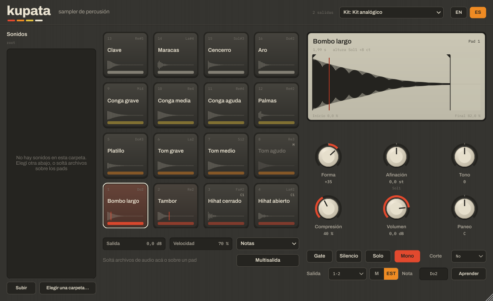

# Kupata

**Sampler de percusión de 16 pads** para VST3, CLAP, AU y como aplicación independiente, en macOS y Windows, en el espíritu de Sitala.

Cada pad tiene un sonido y seis perillas: **Forma, Afinación, Tono, Compresión, Volumen y Paneo**. Forma y Compresión trabajan sobre la envolvente del propio sonido, medida al cargarlo, así que se comportan de manera musical con cualquier sonido y mantienen su volumen. Trae un **kit analógico** de dieciséis sonidos sintetizados desde cero, al estilo de las cajas de ritmo de los 80, que se puede usar libremente.



## Descargar e instalar

1. Entrá a **[Releases](../../releases)** y bajá el paquete de tu sistema: `Kupata-…-macOS.zip` o `Kupata-…-Windows.zip`.
2. Descomprimilo y seguí las instrucciones del archivo `LEEME.txt` que viene adentro. Hay un instalador para cada sistema.

Las versiones de prueba, que todavía no se publicaron como Release, están en la pestaña **[Actions](../../actions)**: abrí la última compilación exitosa y bajá el paquete desde *Artifacts* (hace falta una cuenta de GitHub).

## Cómo se usa

- **Tocar**: las notas desde Do2 (C2) tocan los pads 1 a 16; el pad 1 está abajo a la izquierda, como en una MPC. Un clic en un pad lo toca y lo elige (más abajo en el pad, más fuerte). **Notas** cambia el mapa de todo el kit: cromático, teclas blancas o batería General MIDI. **Aprender** (o clic derecho en un pad) le asigna la próxima tecla que toques.
- **Cargar sonidos**: soltá uno o varios archivos sobre un pad (WAV, AIFF, FLAC, Ogg; en Mac también MP3 y otros); varios archivos llenan los pads siguientes. También desde el navegador **Sonidos**: un clic escucha, las flechas recorren la carpeta escuchando cada sonido, doble clic o arrastrar a un pad carga. Clic derecho en un pad: cargar, sonido de fábrica, copiar, pegar, volver las perillas al inicio, vaciar.
- **Ordenar**: arrastrá un pad sobre otro para intercambiarlos, con Alt para copiarlo. Las notas quedan en su lugar: el sonido se muda con sus perillas.
- **Recortar**: en la pantalla, arrastrá los marcadores de inicio y final. El silencio del principio y del final de cada archivo se quita solo, para que suene a tiempo. La forma oscura es el sonido tal como suena ahora, con sus perillas; la clara, el original.
- **Golpes**: si un archivo tiene varios golpes (un loop, por ejemplo), Kupata los encuentra. Las flechas eligen cuál toca el pad, **Entero** toca el archivo completo y **Golpes a pads** pone cada golpe en su propio pad, desde el elegido en adelante.
- **Kit**: guarda y carga kits enteros, con sus sonidos y todas sus perillas, en Documentos/Kupata/Kits. **Kit analógico** vuelve al de fábrica.
- **Idioma**: botones EN / ES. Los parámetros aparecen en inglés en el DAW.

## Las seis perillas

| Perilla | Qué hace |
|---|---|
| Forma | Hacia la izquierda acorta el sonido con un desvanecimiento cada vez más rápido, hasta dejar solo el clic del ataque. Hacia la derecha levanta la cola (más sostén) y, pasada la mitad, suaviza el ataque. El volumen se mantiene. |
| Afinación | ±24 semitonos. Como en una cinta, el sonido se acorta al subir y se alarga al bajar. Debajo aparece la nota en la que suena, si el sonido tiene altura. |
| Tono | Hacia la izquierda oscurece, con un poco de resonancia al final del recorrido; hacia la derecha quita graves y agrega brillo. El recorrido se adapta al brillo de cada sonido: un bombo y un platillo responden en su registro. |
| Compresión | Más pegada y más sostén: baja el comienzo fuerte más que el cuerpo y compensa el volumen solo. |
| Volumen | De −∞ a +6 dB. |
| Paneo | Posición estéreo. |

Cada pad tiene además **Gate** (el sonido se corta al soltar la nota), **Silencio**, **Solo** y un grupo de **Corte** (los pads del mismo grupo se cortan entre sí: en el kit analógico, el hihat cerrado corta al abierto). **Velocidad**, debajo de los pads, ajusta cuánto cambia el nivel según la fuerza de cada nota.

Todas son parámetros del DAW, con su propia automatización: «P1 Shape», «P1 Tune» … «P16 End», además de «Output» y «Velocity».

## Salidas separadas

Kupata usa tantos canales como tenga la pista, hasta 64; el encabezado muestra cuántos. Con **Multisalida**, cada pad sale por su propio par (pad 1 por 1-2, pad 2 por 3-4…). También podés elegir el canal de cada pad en **Salida**, en un par (**EST**) o en un canal solo (**M**). Si un pad apunta a un canal que la pista no tiene, suena por 1-2.

### En REAPER

Como VST3, Kupata se entiende con REAPER:

- **Al insertarlo en una pista nueva** («Insertar instrumento virtual en pista nueva»), Kupata se presenta con 32 salidas, un par por pad, y REAPER ofrece construir el ruteo de salidas múltiples. Si aceptás, Kupata lo nota, manda cada pad a su par y les pone a las pistas nuevas el nombre de los pads.
- **Para hacerlo después**, en una pista que ya tiene Kupata: **Multisalida → Crear una pista por pad en REAPER**. Kupata le da 32 canales a su pista, crea debajo una carpeta con dieciséis pistas (una por pad, con su nombre, cada una recibiendo su par) y apaga el envío de la pista de Kupata al master, para que nada suene dos veces. Se deshace en un solo paso con Ctrl+Z / Cmd+Z.
- **Los nombres siguen a los pads**: si cambiás el sonido de un pad, o el idioma, su pista cambia de nombre. Si renombraste una pista a mano, Kupata la deja como está.
- Kupata sabe cuántos canales tiene de verdad la pista, así que un pad que apunta a un canal que no existe se oye por 1-2 en lugar de quedar mudo.

Esto funciona con el VST3. Con el CLAP o el AU, Multisalida funciona igual, pero las pistas se arman a mano: poné «Track channels» de la pista en la cantidad que quieras y mandá esos canales a otras pistas desde el botón de enrutamiento.

## Sesiones

Los sonidos de hasta 12 segundos se guardan dentro de la sesión del DAW, así que siguen sonando aunque muevas o borres los archivos. Los más largos se buscan en su lugar; si no están, el pad lo avisa y con clic derecho → *Buscar el archivo…* lo volvés a cargar. Los kits guardados llevan siempre todos sus sonidos adentro.

## El kit analógico

Los dieciséis sonidos se generan con [`tools/sintetizar_kit.py`](tools/sintetizar_kit.py) siguiendo los principios de los circuitos de las cajas de ritmo analógicas de los 80: resonadores amortiguados golpeados por un pulso (bombos, tambores, toms, aro, clave), ruido filtrado (palmas, maracas) y un banco de seis osciladores cuadrados desafinados para los metales (hihats, platillo, cencerro). No usa muestras de ninguna máquina ni de ninguna librería, así que se puede compartir y usar en cualquier música sin pedir permiso. Para cambiarlo, editá el script y volvé a correrlo: escribe los archivos de `Resources/kit`.

## Compilar

Hace falta CMake 3.22 o posterior y un compilador de C++17. JUCE y las extensiones CLAP se descargan solas.

```
cmake -B build -DCMAKE_BUILD_TYPE=Release
cmake --build build --config Release
ctest --test-dir build -C Release
```

Con `-DKUPATA_SNAPSHOT=ON` se compilan además una prueba que carga el VST3 como un DAW y una herramienta que guarda una captura de la interfaz (`kupata_snapshot captura.png es`), prueba la reproducción (`--play`), las sesiones y los kits (`--state`), el trabajo con REAPER sobre una imitación de su API (`--reaper`), o graba un patrón de prueba con el kit (`--demo demo.wav`).

## Licencia

GNU AGPL 3.0 o posterior. Usa [JUCE](https://juce.com) (AGPL), las fuentes Archivo e IBM Plex Mono (SIL Open Font License, en `Resources/fonts`), [clap-juce-extensions](https://github.com/free-audio/clap-juce-extensions) y la interfaz de extensiones de REAPER de Cockos ([reaper-sdk](https://github.com/justinfrankel/reaper-sdk), licencia zlib). Los sonidos del kit analógico (`Resources/kit`) se pueden usar en cualquier obra, sin atribución.
